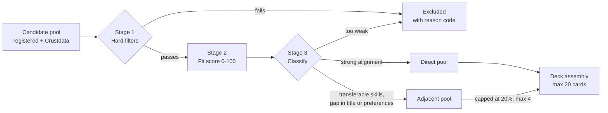
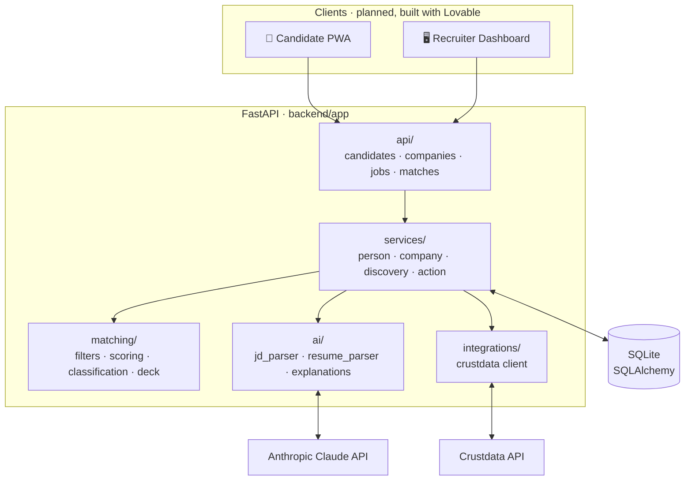
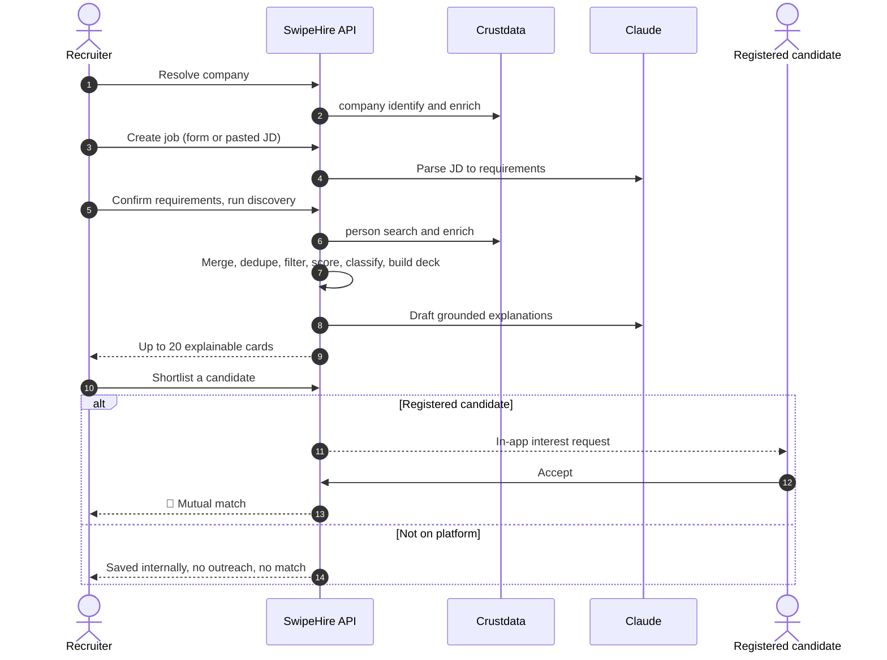

<div align="center">

# 🃏 SwipeHire

### Discover talent beyond keywords.

**Paste a job description. Get a swipeable, explainable shortlist, including the strong candidates a keyword search would have buried.**

<br/>


[**The Idea**](#-the-idea) · [**How Matching Works**](#-how-matching-works) · [**Architecture**](#-architecture) · [**Quick Start**](#-quick-start) · [**API**](#-api-reference) · [**Roadmap**](#-status--roadmap)

</div>

---

## 💡 The Idea

Most hiring search is a glorified `Ctrl+F`. If a candidate's title says *"Platform Engineer"* and your JD says *"Backend Engineer"*, they never show up, even if they've shipped exactly what you need.

**SwipeHire separates _eligibility_ from _ranking_:**

> 🚧 **Must-haves are non-negotiable.** Fail one and you're out, with a stated reason.
> 🎯 **Everything else is scored.** The score is deterministic code, not an LLM's vibes.
> 🧭 **Adjacent-fit candidates get a seat.** They pass every mandatory requirement but wear a different title or miss a nice-to-have.

The result is a deck of up to **20 explainable candidate cards**, drawn from your own registered users **and** the [Crustdata](https://crustdata.com) people graph, ready to swipe.

```text
┌─────────────────────────────────────────┐
│  #3  ·  Priya N.            ◆ ADJACENT  │
│  Platform Engineer @ Streamly           │
│                                         │
│  Fit  ████████████████░░░░  78 / 100    │
│  Evidence coverage  ████████░░  0.80    │
│                                         │
│  [Python] [FastAPI] [Kubernetes]        │
│                                         │
│  "Matches 3/3 must-have skills. Title   │
│   differs, but her infra work maps      │
│   directly onto the role."              │
│                                         │
│  ○ Registered      ✗ Pass   ★ Save  ♥ Shortlist │
└─────────────────────────────────────────┘
        ↑ illustrative card, not real data
```

---

## ✨ Highlights

| | |
|---|---|
| 🧠 **Adjacent-fit discovery** | A capped slice of the deck (max 20%, never more than 4) goes to strong transferable candidates, never as filler. |
| 🔒 **Fail-closed filtering** | Unknown data on a *required* field is not a pass. Exclusions are stored with stable reason codes. |
| 🧮 **Deterministic scoring** | Five weighted components, reproducible and auditable. Claude parses and explains but never sets the score. |
| 🔍 **Evidence coverage** | Every score ships with a 0–1 coverage indicator, so a 90 built on a thin profile isn't presented like a 90 built on a full one. |
| 🧬 **Person ≠ User** | Crustdata-sourced people can be shortlisted without an account. They're labelled *Not on platform* and can't enter the match flow. |
| 🤝 **Two-sided matching** | A mutual match exists only when a *registered* candidate accepts. Nothing leaves the app. |
| 🛡️ **Privacy-minded** | A tested sanitizer masks candidate salary unless the candidate opts to share it. *(Wiring it into the recruiter-facing routes is on the roadmap.)* |
| 🔌 **Resilient Crustdata client** | Typed errors, TTL caching, exponential backoff with jitter on 429/5xx, and no retries on non-retryable 4xx. |

---

## 🎯 How Matching Works

Every candidate goes through three stages. All of it lives in [`backend/app/matching/`](backend/app/matching).



### Stage 1: Hard filters
Only **explicitly mandatory** requirements count: must-have skills, mandatory qualifications, experience bounds, required fields and dealbreakers like location or work mode. An ambiguous JD phrase never silently becomes a filter.

> **Unknown ≠ pass.** If a field is required and missing, the candidate is excluded. If it's *optional* and missing, it stays `Unknown / Needs confirmation`.

### Stage 2: Fit score

```text
fit_score = 0.30·skills + 0.25·experience + 0.20·role_domain + 0.15·trajectory + 0.10·context
```

| Component | Weight | What it looks at |
|---|:--:|---|
| 🛠️ Skills | `30%` | Must-have and preferred coverage (70/30 split), including skills found in resume highlights |
| 📈 Experience | `25%` | Years vs. the requested min/max band |
| 🎯 Role & domain | `20%` | Title alignment: exact, keyword overlap, or shared functional role |
| 🪜 Trajectory | `15%` | Seniority fit and career progression |
| 📍 Context | `10%` | Location and work-mode alignment |

Each component is normalized to 0–100 and stored with a human-readable reason.

### Stage 3: Direct vs. adjacent

| | Fit score | Skills | Role/domain | Notes |
|---|:--:|:--:|:--:|---|
| **Direct** | ≥ 70 | ≥ 60 | ≥ 70 | Strong on title, skills and domain |
| **Adjacent** | ≥ 50 | ≥ 40 *(or experience ≥ 50)* | ≥ 35 | Passes every hard filter, with a gap in title or preferences |

> Thresholds are engineering defaults, centralized in [`classification.py`](backend/app/matching/classification.py) so the team can calibrate them.

### Deck assembly

- Up to **20 cards**, ranked by `(fit_score ↓, evidence_coverage ↓, person_id ↑)`, so the order is fully stable.
- Adjacent candidates may fill **at most 20% of the displayed deck** (≤ 4 of 20).
- It's a **cap, not a quota**. If only one strong adjacent candidate exists, only one appears.
- Candidates who pass the filters but don't make the deck are recorded with a reason: `insufficient_fit_or_evidence`, `deck_capacity_reached` or `adjacent_cap_reached`.

---

## 🏗️ Architecture



**Design rules the codebase follows:**

1. 🔐 **Secrets stay server-side.** Crustdata and Anthropic keys never reach a browser.
2. 🧱 **Adapters absorb third-party shapes.** Raw Crustdata responses are normalized in `integrations/` and `services/`, so nothing else depends on them.
3. 🤖 **LLMs parse and explain, code decides.** Claude turns JDs and resumes into validated Pydantic objects and drafts two-sentence explanations, with a deterministic fallback if the call fails.
4. 🪪 **One canonical `Person`.** Deduplicated by Crustdata person ID and normalized profile URL, so a sourced person who later registers is *attached*, not duplicated.

### Tech stack

| Layer | Choice |
|---|---|
| API | **FastAPI** + Uvicorn |
| Validation | **Pydantic v2** / pydantic-settings |
| Persistence | **SQLAlchemy 2.0**, SQLite for the prototype |
| LLM | **Anthropic Claude** (default model `claude-sonnet-5-5`) |
| Talent data | **Crustdata** REST API (`x-api-version: 2025-11-01`) |
| HTTP client | `httpx` (async) |
| Tests | `pytest` + `pytest-asyncio` |
| Frontend *(planned)* | Lovable-generated React / TypeScript / Tailwind, calling this API |

---

## 🔄 The Full Loop



> **No external outreach, ever.** No emails, no LinkedIn messages. Every interaction stays inside the app.

---

## 🚀 Quick Start

**Prerequisites:** Python 3.10+, a [Crustdata](https://crustdata.com) API key and an [Anthropic](https://console.anthropic.com) API key.

```bash
# 1. Clone the shourya branch
git clone -b shourya https://github.com/ninjayush/swipehire.git
cd swipehire

# 2. Create an environment and install
cd backend
python -m venv .venv
source .venv/bin/activate            # Windows: .venv\Scripts\activate
pip install -r requirements.txt

# 3. Configure secrets
cp ../.env.example ../.env           # then open .env and add your keys

# 4. Run the API
uvicorn app.main:app --reload --port 8000
```

Then open:

| | URL |
|---|---|
| 📖 Interactive API docs (Swagger) | http://localhost:8000/docs |
| 💚 Health check (includes a Crustdata connectivity probe) | http://localhost:8000/health |

On first boot the app creates the database and **seeds a demo company** (*Demo Corp*), a **demo recruiter** and a **sample job** (*Senior Full-Stack Engineer*), so you can start exploring immediately.

### ⚙️ Configuration

| Variable | Default | Purpose |
|---|---|---|
| `CRUSTDATA_API_KEY` | — | Crustdata auth *(the lowercase alias `crust_api_key` also works)* |
| `CRUSTDATA_BASE_URL` | `https://api.crustdata.com` | Crustdata endpoint |
| `CRUSTDATA_API_VERSION` | `2025-11-01` | Sent as the `x-api-version` header |
| `ANTHROPIC_API_KEY` | — | Claude access for JD/resume parsing and explanations |
| `ANTHROPIC_MODEL` | `claude-sonnet-5-5` | Claude model used |
| `DATABASE_URL` | SQLite file in `backend/` | Persistence |
| `UPLOAD_DIR` | `backend/uploads` | Resume storage |
| `DEBUG` / `HOST` / `PORT` | `True` / `0.0.0.0` / `8000` | Server settings |

`.env` is git-ignored. Only `.env.example` is committed.

### 🧪 Run the tests

```bash
cd backend
python -m pytest tests
```

The suite covers hard filters (pass, fail, unknown-required, unknown-optional), score bounds, the adjacent cap and no-filler rule, identity deduplication, the Crustdata client, onboarding, discovery, recruiter actions and the mutual-match state machine. It runs offline with no live API calls.

---

## 📡 API Reference

All routes are documented interactively at `/docs`. Summary:

<details open>
<summary><b>🏢 Companies</b></summary>

| Method | Route | Purpose |
|---|---|---|
| `POST` | `/api/companies/resolve` | Identify and enrich a company via Crustdata |

</details>

<details open>
<summary><b>💼 Jobs & deck</b></summary>

| Method | Route | Purpose |
|---|---|---|
| `POST` | `/api/jobs` | Create a job from structured fields or a pasted JD |
| `GET` | `/api/jobs` | List jobs |
| `PATCH` | `/api/jobs/{id}` | Update/confirm a job's requirements |
| `POST` | `/api/jobs/{id}/discover` | Run discovery, filtering, scoring and deck generation |
| `GET` | `/api/jobs/{id}/deck` | Fetch the ranked candidate deck |
| `GET` | `/api/jobs/{id}/shortlist` | Fetch shortlisted candidates |
| `POST` | `/api/jobs/{id}/actions` | Record `shortlist` / `pass` / `save` |

</details>

<details open>
<summary><b>🙋 Candidates</b></summary>

| Method | Route | Purpose |
|---|---|---|
| `POST` | `/api/candidates/enrich` | Enrich a profile URL via Crustdata |
| `POST` | `/api/candidates/register` | Save a candidate profile and preferences |
| `POST` | `/api/candidates/{id}/resume` | Upload a resume (PDF/DOCX, size-capped, safe filenames) |
| `GET` | `/api/candidates/{id}` | Fetch a candidate profile |
| `GET` | `/api/candidates/{id}/interests` | List incoming recruiter interest |

</details>

<details open>
<summary><b>🤝 Matches</b></summary>

| Method | Route | Purpose |
|---|---|---|
| `POST` | `/api/interests/{id}/respond` | Candidate accepts or rejects (idempotent; accept creates the match) |
| `GET` | `/api/matches` | List mutual matches |
| `GET` | `/` · `/health` | Service info · health + Crustdata probe |

</details>

---

## 🗂️ Project Structure

```text
swipehire/
├── backend/
│   ├── app/
│   │   ├── main.py              # App factory, CORS, lifespan, demo seeding
│   │   ├── config.py            # Typed settings (.env aware)
│   │   ├── api/                 # candidates · companies · jobs · matches
│   │   ├── services/            # person · company · discovery · action
│   │   ├── matching/            # normalization · filters · scoring · classification · deck
│   │   ├── ai/                  # anthropic_client · jd_parser · resume_parser · explanations
│   │   ├── integrations/        # crustdata client + diagnostics
│   │   ├── models/              # SQLAlchemy models
│   │   └── database/            # engine/session + canonical Pydantic schemas
│   ├── tests/                   # 128 tests: unit, contract and integration
│   ├── uploads/                 # resume storage (git-ignored contents)
│   └── requirements.txt
├── context.md                   # Product decisions, policies and guardrails
├── to-do.md                     # Implementation checklist
├── TEAM_MERGE_GUIDE.md          # Parallel workstream + merge protocol
├── .env.example
└── README.md
```

<details>
<summary><b>🗃️ Data model</b></summary>

A canonical **`Person`** is deliberately separate from a registered **`User`**, because a Crustdata-sourced professional may have no account.

`User` · `Person` · `CandidateProfile` · `Resume` · `Company` · `CompanyMember` · `JobRole` · `MatchRun` · `CandidateMatch` · `EvidenceItem` · `RecruiterAction` · `InterestRequest` · `Match`

</details>

---

## 🧭 Product Principles

1. **Strict eligibility, flexible ranking.** Only explicit must-haves filter.
2. **Adjacent never bypasses mandatory.** It can miss preferences, never requirements.
3. **Unknown required data fails closed.** Unknown optional data stays unknown.
4. **No unsupported verification claims.** Crustdata-enriched data is profile-based, not independently verified employment history.
5. **Never fabricate.** No invented resumes, availability, salary or consent for sourced non-members.
6. **JD text is data, not instructions.** It's untrusted input to the LLM.
7. **Non-members can't mutual-match** until they register and link to their existing `Person`.

Full detail lives in [`context.md`](context.md).

---

## 📍 Status & Roadmap

| Area | Status |
|---|:--:|
| Crustdata client: person/company enrich, search and identify, caching, retries | ✅ |
| Canonical `Person` model with identity dedup and registration linking | ✅ |
| JD parser and resume parser (Claude + Pydantic validation) | ✅ |
| Hard filters, deterministic scoring, direct/adjacent classification | ✅ |
| Deck assembly with the adjacent cap and grounded explanations | ✅ |
| Recruiter actions, interest requests and mutual-match state machine | ✅ |
| Salary privacy sanitizer (implemented and unit-tested) | ✅ |
| Apply the sanitizer in recruiter-facing deck/shortlist responses | 🚧 Not wired in yet |
| Test suite (128 passing, 1 skipped) | ✅ |
| Recruiter dashboard and candidate PWA (Lovable) | 🚧 Not in this branch yet |
| Real PDF/DOCX text extraction | 🚧 See note below |
| Authentication / login | ⏳ Not started (demo uses seeded users) |
| Local semantic embeddings (Sentence Transformers) | 💭 Optional |
| Watcher alerts, company/job search, multi-resume profiles | 💭 Later |

> ⚠️ **Known gap: resume text extraction.** The upload route validates type and size, stores the file safely and hands text to the Claude parser, but it currently decodes the raw bytes as UTF-8. That's fine for plain-text resumes, but real PDF/DOCX files need a proper extractor (PyMuPDF for PDF, `python-docx` for DOCX) before resume parsing is reliable. Neither library is in `requirements.txt` yet.

---

## 🧱 Prototype Scope

Intentionally **out of scope** for now: external email or LinkedIn outreach, real interviews, a full messaging system, calendar integration, community feeds, GitHub enrichment, dedicated work-history verification, continuous Watcher notifications and advanced analytics.

---

## 📚 More Docs

- [`context.md`](context.md): the source of truth for product behavior, matching policy and coding guardrails
- [`to-do.md`](to-do.md): implementation checklist and demo checklist
- [`TEAM_MERGE_GUIDE.md`](TEAM_MERGE_GUIDE.md): workstream ownership and interface freeze
- [`backend/README.md`](backend/README.md): backend developer guide

---

<div align="center">

**Built so the best candidate doesn't get lost behind a job title.**

⭐ Star the repo if you believe hiring should look past the keywords.

</div>
