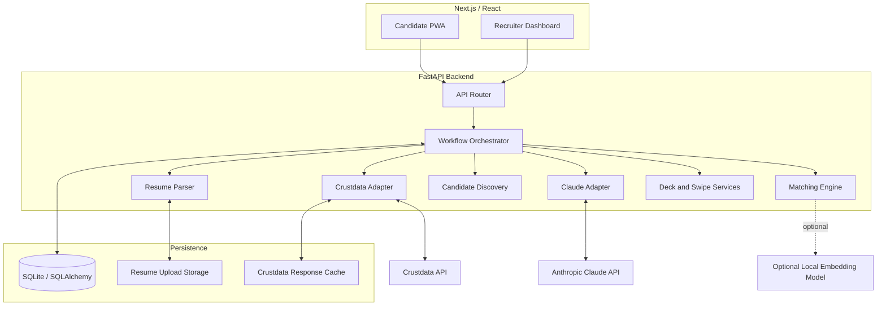
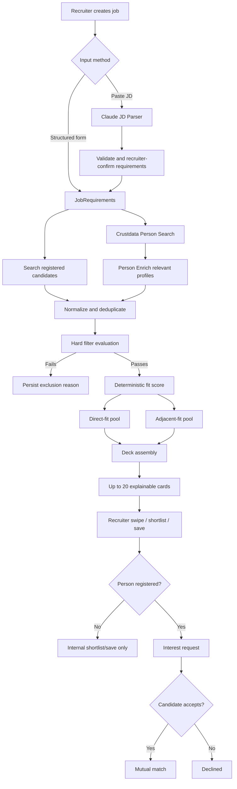

# SwipeHire

> **Discover talent beyond keywords.**

SwipeHire is a recruiter-first hiring platform that turns a job description into an explainable, swipeable candidate deck. It combines registered candidates with Crustdata-discovered professionals, enriches available profile information, applies mandatory eligibility filters, ranks candidates, and dynamically includes strong adjacent-fit candidates who may be overlooked by literal keyword matching.

## Product overview

SwipeHire has two experiences sharing one backend and one frontend codebase:

- **Candidate PWA:** Mobile-first onboarding using a LinkedIn/profile URL and resume, profile confirmation, preferences, and local in-app responses to recruiter interest.
- **Recruiter web dashboard:** Company onboarding, job creation through a structured form or pasted JD, candidate discovery, candidate cards, swipe/shortlist/pass/save actions, and mutual-match management.

### Core promise

A recruiter submits a JD. SwipeHire discovers and evaluates candidates using the Crustdata people/company graph and presents up to 20 explainable candidate cards — including strong adjacent-fit candidates who pass all mandatory requirements but may miss some preferred criteria.

## Core differentiator: adjacent-fit discovery

Most basic hiring search experiences rely heavily on literal job-title and skill keywords. SwipeHire separates eligibility from ranking:

1. **Hard filters:** Apply only explicitly mandatory requirements and dealbreakers. Candidates who fail any hard filter are excluded with a reason.
2. **Fit score:** Score eligible candidates on skills, experience, role/domain alignment, career trajectory, and contextual fit.
3. **Adjacent fit:** Include a limited number of high-quality candidates with transferable capabilities who pass every hard filter but miss one or more preferred criteria or literal terminology alignment.

For a 20-card deck, adjacent-fit candidates are capped at four (20%). This is a maximum, not a quota. Never add a weak candidate solely to fill an adjacent slot.

## Architecture

### Technology stack

| Layer | Choice | Responsibility |
|---|---|---|
| Frontend | Next.js, React, TypeScript | Shared candidate and recruiter application |
| Candidate client | Installable mobile-first PWA | Profile onboarding and candidate interest responses |
| Recruiter client | Desktop web dashboard | Company, job, discovery, and swipe deck |
| Backend | FastAPI / Python | API routes, orchestration, data services |
| Database | SQLite + SQLAlchemy (prototype) | Users, persons, companies, jobs, matches, actions |
| LLM | Anthropic Claude API | JD parsing, resume structuring, match explanations |
| Resume extraction | PyMuPDF + python-docx | Extract text from PDF/DOCX |
| Matching | Deterministic Python scoring | Hard filters, scores, direct/adjacent classification |
| Optional embeddings | Local Sentence Transformers | Semantic similarity, if time permits |
| External data | Crustdata REST API | People/company search, identify, enrich |
| File storage | Local `uploads/` directory (prototype) | Uploaded resumes |

Anthropic Claude is used for language tasks, not as the final scoring authority. Anthropic does not provide its own general-purpose embeddings API. The MVP must work without a second paid embeddings key; structured matching and skill normalization are the fallback, with local embeddings optional.

### High-level system diagram



### Backend module responsibilities

- `integrations/crustdata.py`: authentication, endpoint wrappers, pagination, retry/backoff, caching, raw-response normalization.
- `integrations/anthropic.py`: Claude Messages API client and structured-output helpers.
- `services/jd_parser.py`: raw JD → validated `JobRequirements`.
- `services/resume_parser.py`: PDF/DOCX text extraction → Claude structured resume data.
- `services/candidate_discovery.py`: internal candidate lookup + Crustdata Person Search + Person Enrich + deduplication.
- `services/matching_engine.py`: hard filters, deterministic component scoring, direct/adjacent classification, evidence coverage.
- `services/deck_generator.py`: rank candidates and apply adjacent-fit cap.
- `services/match_service.py`: recruiter actions, candidate responses, mutual-match state transitions.

## End-to-end pipeline



### Pipeline details

#### 1. Company onboarding

1. Recruiter enters company name or domain.
2. Backend calls `POST /company/identify`.
3. Recruiter selects the correct canonical match if needed.
4. Backend calls `POST /company/enrich` using the canonical Crustdata company ID.
5. Store the company identity and relevant enriched fields.

#### 2. Job creation

The recruiter uses a structured form or pastes a JD. Claude extracts title, seniority, experience bounds, must-have skills, preferred skills, locations, work mode, and explicit dealbreakers. Validate the returned JSON and let the recruiter confirm the result. Ambiguous statements must not silently become hard filters.

#### 3. Candidate sourcing

- Query registered candidates from SwipeHire's database.
- Call `POST /person/search` with a job-specific query and permitted filters.
- Enrich relevant external profiles with `POST /person/enrich`.
- Normalize both sources into the canonical internal `Person` model.
- Deduplicate using Crustdata person ID and normalized professional-network URL.

#### 4. Eligibility filtering

A candidate must pass every explicitly mandatory requirement. If a required field is missing, exclude the candidate with a precise reason such as `availability_unknown_required`. Missing optional fields remain unknown and are displayed as `Needs confirmation`.

#### 5. Scoring and classification

Initial proposed weights:

| Component | Weight |
|---|---:|
| Skill / competency similarity | 30% |
| Relevant experience and achievements | 25% |
| Role and domain alignment | 20% |
| Seniority and career trajectory | 15% |
| Contextual preferences / fit | 10% |

`fit_score = 0.30*skills + 0.25*experience + 0.20*role_domain + 0.15*trajectory + 0.10*context`

All component scores are normalized to 0–100. The score is deterministic and stored alongside component reasons and an evidence-coverage indicator. Claude may write the explanation using supplied evidence but cannot invent facts or set the final score.

#### 6. Direct and adjacent candidate deck

- Direct fit: passes all hard filters and strongly aligns with the stated role and requirements.
- Adjacent fit: passes all hard filters, has strong transferable capabilities, but misses some preferred criteria or literal terminology alignment.
- The deck target is up to 20 candidates.
- At most 20% of the deck may be adjacent (at most four in a 20-card deck).
- This is a cap, not a quota. Do not fill slots with weak candidates.

#### 7. Swipe and match

- Recruiter right swipe / shortlist: express interest for registered candidates; create internal shortlist action for sourced non-members.
- Recruiter left swipe: pass.
- Save/maybe: save candidate for later.
- Registered candidate receives an in-app interest request and may accept or reject it.
- Only acceptance by a registered candidate creates a mutual match.
- Sourced non-members are labelled `Not on platform` and cannot receive notifications or enter mutual-match flow until registered and linked to the existing canonical Person.

## Crustdata API integration

Base URL: `https://api.crustdata.com`

Required headers:

```http
Authorization: Bearer <CRUSTDATA_API_KEY>
Content-Type: application/json
x-api-version: 2025-11-01
```

| Endpoint | Use in SwipeHire | Priority |
|---|---|---|
| `POST /person/enrich` | Candidate LinkedIn/profile enrichment | Core |
| `POST /person/search` | External candidate discovery | Core |
| `POST /company/identify` | Company canonical identity resolution | Core |
| `POST /company/enrich` | Company onboarding data | Core |
| `POST /company/search` | Optional company search / dream list | Later |
| `POST /job/search` | Optional hiring context | Later |
| `POST /web/search/live` | Additional public context | Later |
| `POST /web/enrich/live` | Fetch public source pages | Later |
| Watcher APIs | Profile/job/company change monitoring | Later |

Account permissions, enabled fields, rate limits, and credits are key-specific. Check them before relying on optional endpoints or field groups. Request only necessary fields, cache results, use cursor pagination where applicable, and implement bounded retry/backoff. Keep API credentials in the backend only.

## Data model

A canonical `Person` must be separate from a registered `User`, because Crustdata-sourced candidates may not have a SwipeHire account.

| Entity | Main purpose |
|---|---|
| `User` | Registered candidate/recruiter account |
| `Person` | Canonical person identity; optional Crustdata ID and profile URL |
| `CandidateProfile` | Candidate preferences and platform-only data |
| `Resume` | Original file, extracted text, parsed resume JSON |
| `Company` | Canonical company identity and enriched fields |
| `CompanyMember` | Recruiter-to-company association |
| `JobRole` | Raw JD and normalized requirements |
| `MatchRun` | Candidate discovery execution record |
| `CandidateMatch` | Job/person evaluation, score, fit type, rank and explanation |
| `RecruiterAction` | Shortlist, pass, or save action |
| `InterestRequest` | Recruiter interest awaiting a registered candidate's response |
| `Match` | Mutual match created after acceptance |
| `EvidenceItem` | Claim, value, source and provenance details |

Unique constraints should be applied to non-null Crustdata person IDs and normalized profile URLs. When a sourced person registers, attach the account to the existing Person record instead of creating a duplicate.

## API contract: internal backend routes

| Method | Route | Purpose |
|---|---|---|
| POST | `/api/candidates/enrich` | Enrich a LinkedIn/profile URL |
| POST | `/api/candidates/register` | Save candidate profile and preferences |
| POST | `/api/candidates/{id}/resume` | Upload and parse resume |
| GET | `/api/candidates/{id}` | Get candidate profile |
| POST | `/api/companies/resolve` | Identify and enrich company |
| POST | `/api/jobs` | Create job from structured requirements or JD |
| GET | `/api/jobs` | List company jobs |
| POST | `/api/jobs/{id}/discover` | Trigger candidate discovery and deck generation |
| GET | `/api/jobs/{id}/deck` | Get ranked candidate deck |
| GET | `/api/jobs/{id}/shortlist` | Get shortlisted candidates |
| POST | `/api/jobs/{id}/actions` | Shortlist/pass/save action |
| GET | `/api/candidates/{id}/interests` | Candidate's incoming interest requests |
| POST | `/api/interests/{id}/respond` | Accept/reject interest |
| GET | `/api/matches` | List mutual matches |

These are proposed SwipeHire backend routes, not Crustdata routes.

## Key product and engineering decisions

1. **Recruiter-first:** the primary demo path starts with a company and a job description.
2. **Hybrid sourcing:** combine registered candidates and Crustdata records in one canonical Person model.
3. **Person ≠ User:** a sourced professional may not have an account.
4. **Strict eligibility, flexible ranking:** only explicit mandatory requirements filter candidates; preferences contribute to score.
5. **Adjacent candidates cannot bypass must-haves:** they can miss preferred criteria, not required criteria.
6. **Dynamic adjacent allocation:** up to 20% of the deck, with no forced quota.
7. **Unknown required data fails closed:** if a mandatory field is unknown, exclude with a reason. Unknown optional data remains unknown.
8. **Deterministic score:** LLMs parse and explain; backend code filters and scores.
9. **No unsupported verification claims:** Crustdata-enriched profile data is not described as independently verified.
10. **Non-members cannot mutual-match:** sourced non-members can be shortlisted/saved only.
11. **One shared frontend:** candidate PWA and recruiter dashboard live in the same Next.js app.
12. **No external outreach in the hackathon:** all responses and notifications in the demo are local/in-app.
13. **MVP over breadth:** complete the JD → candidate deck → recruiter action → (registered candidate) acceptance loop before optional features.

## Local development setup

The following is the intended setup once the repository and application code have been created.

### Backend

```bash
cd backend
python -m venv .venv
source .venv/bin/activate
pip install -r requirements.txt
cp ../.env.example .env
uvicorn app.main:app --reload --port 8000
```

### Frontend

```bash
cd frontend
npm install
npm run dev
```

The frontend should call the FastAPI backend through a configured base URL (for example, `NEXT_PUBLIC_API_BASE_URL=http://localhost:8000`). Never put Crustdata or Anthropic secrets in `NEXT_PUBLIC_*` variables.

### Environment variables

```env
CRUSTDATA_API_KEY=
ANTHROPIC_API_KEY=
ANTHROPIC_MODEL=
DATABASE_URL=sqlite:///./swipehire.db
UPLOAD_DIR=./uploads
NEXT_PUBLIC_API_BASE_URL=http://localhost:8000
```

Keep real `.env` files out of Git. The commands above are a proposed scaffold; adjust paths if the team changes the repository layout.

## Scope exclusions for the prototype

- External email / LinkedIn outreach.
- Real calls or interviews with external candidates.
- Full messaging system.
- Calendar integration.
- Community/alumni feed.
- GitHub enrichment.
- Dedicated career verification API.
- Continuous Watcher notifications.
- Dream-candidate sourcing.
- Multiple target-role profiles and multiple resumes per candidate.
- Advanced analytics.

## Demo acceptance criteria

The demo should show one previously unseen JD going through the complete workflow:

1. Resolve/enrich a company through Crustdata.
2. Paste a JD and parse it into structured requirements.
3. Run Crustdata-backed candidate discovery.
4. Merge/deduplicate sourced and registered profiles.
5. Exclude at least one candidate with a clear mandatory-filter reason.
6. Show direct-fit and at least one valid adjacent-fit candidate.
7. Display a candidate card with score, explanation, and source/membership label.
8. Shortlist a sourced non-member and show that mutual matching is unavailable.
9. Shortlist a registered candidate, accept interest in the candidate PWA, and show a mutual match.

No external human outreach should occur during the demo.

## Repository documents

- [`context.md`](context.md) — detailed shared context and coding guardrails.
- [`to-do.md`](to-do.md) — prioritized implementation checklist and demo checklist.
